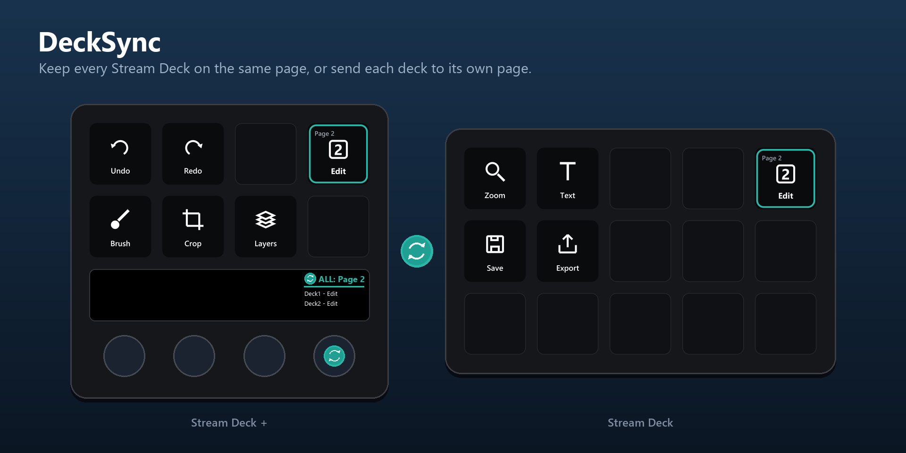

# DeckSync

**Keep every Stream Deck on the same page, or send each deck to its own page.**

DeckSync is a plugin for the Elgato Stream Deck app. Connect two or more Stream Decks to the same computer, and DeckSync keeps their pages in step: turn a page on one deck and the others follow. When you want them apart, a single key or a dial sends each deck to the page you choose.

## Get DeckSync

DeckSync is available on the [Elgato Marketplace](https://marketplace.elgato.com). Search for **DeckSync** in the Stream Deck app's Marketplace and click Install.

## Documentation

| | |
| --- | --- |
| [Installation](docs/Installation.md) | Install, what happens the first time, uninstall |
| [Getting started](docs/Getting-started.md) | Set up your pages in five minutes, and how the sync works |
| [Actions](docs/Actions.md) | Every DeckSync key and its settings |
| [Page dial](docs/Page-dial.md) | The dial on Stream Deck +, step by step |
| [Decks without a dial](docs/No-dial.md) | Page step keys for Stream Deck, Mini, XL and Neo |
| [Virtual Stream Deck](docs/Virtual-Stream-Deck.md) | Use a deck on your screen as a remote |
| [Colours](docs/Colours.md) | Set your own colours with hex codes |
| [Folders](docs/Folders.md) | More keys per page with the app's folders |
| [Troubleshooting](docs/Troubleshooting.md) | Tips, limitations and what to check |

## Features

- **Follow mode.** Every page in a DeckSync profile carries a page marker. When a page appears on one deck, the other decks jump to the same page. No loops, no polling.
- **Works with any Stream Deck.** Decks with dials get a page dial. Decks without get Page step keys for next and previous, which show the page they lead to.
- **Clear keys.** DeckSync keys are black like any Stream Deck key, with a thin frame that lights up when the decks are in sync. Each shows the page number, an icon and the page name.
- **Page names and icons.** Name your pages and give them icons in the Stream Deck app, and DeckSync shows them on the keys, on the dial and in the page lists. Pages without an icon show their number.
- **Page dial** (Stream Deck +). Turn to pick a page, press to go there, hold and turn to choose the target: all decks or a single one. The touch strip shows where every deck is.
- **Go to page.** One key sends all decks, or each deck, to the page you pick.
- **Page indicator.** A display key that shows which page any deck is on. Pin one and it follows you to every page.
- **Virtual Stream Deck as a remote.** Put DeckSync keys on a virtual deck on your screen and control the physical ones from there.
- **Your colours.** Set your own hex codes for the accent, the frame, the background and the text.
- **Deck names.** Call your decks "Editing" and "Stream" instead of their model names.
- **Zero setup.** DeckSync ships a ready profile for every supported device type and installs it the first time a deck is seen.

## Examples

**Follow mode.** Both decks on page 2. The framed keys are the page markers: page number, icon and name. The lit frame means the decks are in sync, and the strip reads `ALL: Page 2`.

**Split.** Stream Deck + stays on page 2 while the other deck is on page 1. The frames are grey, and the strip lists where every deck is.

**Page dial.** Turn to pick a page, press to go there. Hold and turn to choose which deck.

**The dial, step by step.** At rest the strip shows every deck. Turn to pick, press to go, hold and turn to choose the deck.

**No dial required.** Page step keys go to the next or previous page and show where they lead.

**Virtual Stream Deck as a remote.** DeckSync keys on a virtual deck control your physical decks.

## Supported devices

| Device | Keys | Notes |
| --- | --- | --- |
| Stream Deck (MK.2, Scissor Keys, Module 15) | 5 × 3 | |
| Stream Deck Mini | 3 × 2 | |
| Stream Deck XL | 8 × 4 | |
| Stream Deck + | 4 × 2 + 4 dials | Page dial pre-placed on dial 4 of every page |
| Stream Deck Neo | 4 × 2 | |

Requires the Stream Deck app 7.1 or newer on Windows 10+ or macOS 12+.

## Support

Questions and bug reports: https://github.com/BerrisNO/DeckSync/issues

## Privacy

DeckSync runs entirely on your computer. It makes no network requests and collects no data. Settings (deck names, colours, dial state) are stored by the Stream Deck app. Page names and icons are read from the app's own profile files on your computer.

---

© 2026 BerrisNO. DeckSync is sold through the Elgato Marketplace. All rights reserved.
