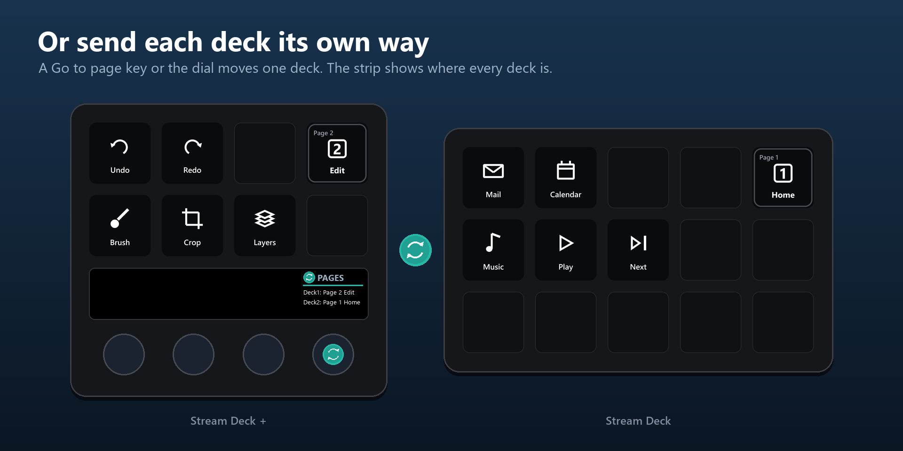

# Actions

[Home](../README.md) · [Installation](Installation.md) · [Getting started](Getting-started.md) · **Actions** · [Page dial](Page-dial.md) · [Decks without a dial](No-dial.md) · [Virtual Stream Deck](Virtual-Stream-Deck.md) · [Colours](Colours.md) · [Folders](Folders.md) · [Troubleshooting](Troubleshooting.md)

---

## Page marker

One per page. The key shows the page's name and icon from the Stream Deck app, with "Page 3" in the corner and a frame that lights up when the other decks are on the same page. Setting **This page** is the page number the marker sits on (pre-filled in the DeckSync profiles). **Others go to page** maps pages freely, e.g. page 2 on this deck sends the others to page 4. Pressing a marker forces a resync.

## Page indicator

A display key in the same style as the page marker, placed wherever you like. It shows which page a deck is on: this deck, or another deck chosen in its settings, whose name is then shown at the bottom. Press it to take this deck to the shown page, or, when it shows its own deck, to resync the others.

Tip: add one Page indicator and pin it to its position in the Stream Deck app. It then follows onto every page and shows the correct name, icon and page number for that deck, so one is enough.

## Page step

Next or previous page on an ordinary key, for decks without a dial. The key shows the page it goes to, with that page's name and icon. Settings: direction (Next, Previous, or "Next, hold for previous" to fit both on one key) and what it moves (all decks, this deck only, or the Target key's choice). The DeckSync profiles for decks without dials come with a Previous and a Next key in the bottom corners.

## Go to page

Pick a page for all decks, or a page per connected deck. Pressing the key, dial or touch strip sends each deck to its page, including the deck the key is on. "Unchanged" leaves that deck where it is.

## Page dial (Stream Deck +)

- **Turn**: pick a page (1–10). The touch strip shows its name, nothing is sent yet.
- **Press**: go to that page on the target decks.
- **Hold and turn**: pick the target: ALL → each deck in turn → ALL, in both directions. Holding without turning does nothing.
- **Touch**: go to the page, same as press.

The chosen page and target are shared by all page dials and remembered across restarts.

## Target

A key that switches the same target as the page dial, and shows the current target.

## Deck names

Open the settings of any Page dial or Target key. One text field per connected deck lets you name it. Names are shown on the strip, in Go to page and on indicators.

## Page names

Pages are named in the Stream Deck app, in the DeckSync profile of each deck. DeckSync reads those names from the app's profile files and updates the markers, the dial and the Go to page lists within a second. With target ALL, the dial shows a page name when every deck agrees on it, otherwise "Page 3".

---

Questions or a bug? Open an issue: https://github.com/BerrisNO/DeckSync/issues
