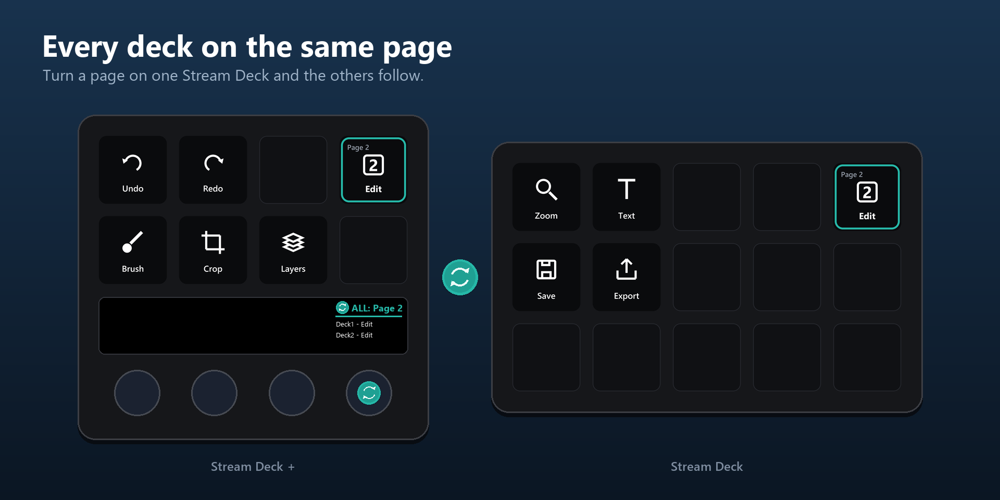

# Getting started

[Home](../README.md) · [Installation](Installation.md) · **Getting started** · [Actions](Actions.md) · [Page dial](Page-dial.md) · [Decks without a dial](No-dial.md) · [Virtual Stream Deck](Virtual-Stream-Deck.md) · [Colours](Colours.md) · [Folders](Folders.md) · [Troubleshooting](Troubleshooting.md)

---

1. Build your pages inside the DeckSync profiles. Keep the page marker on each page; you can move it to any key.
2. **Name the pages and give them icons.** This is what makes DeckSync readable: in the Stream Deck app, right-click a page number in the page bar of a DeckSync profile and set a name and an icon. The page markers then show the icon with the name underneath, the page dial reads "ALL: Page 3 Stream" instead of just "ALL: Page 3", and the Go to page lists show names. Do it on every deck, since each deck has its own profile and its own page names. Pages without a name or icon show "Page 3" and the page number as icon.
3. Change page on any deck, with the page dial, a Go to page key or the app's own Next/Previous page actions if you add them. The other decks follow.
4. Want a deck on a different page? Use a Go to page key, or the page dial on Stream Deck +.

## How it works

The Stream Deck app does not tell plugins when a page changes, and plugins can only switch a device to profiles bundled with the plugin. DeckSync therefore brings its own profile per device type (`DeckSync 15`, `DeckSync Plus`, …), ten pages each, with a **page marker** in the top-right key of every page. Decks with dials get the page dial; decks without get Previous and Next page keys in the bottom corners.

When a marker becomes visible, DeckSync knows which page that deck is showing and moves the other decks to the same page. Switches that DeckSync itself requested are recognised as echoes and never trigger another switch.

---

Questions or a bug? Open an issue: https://github.com/BerrisNO/DeckSync/issues
