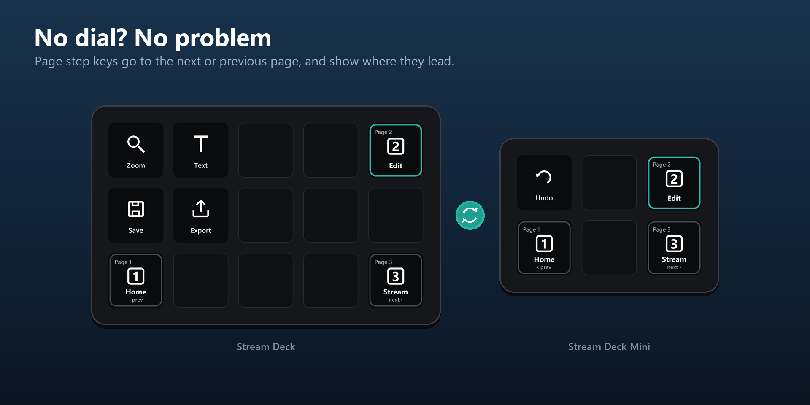

# Decks without a dial

[Home](../README.md) · [Installation](Installation.md) · [Getting started](Getting-started.md) · [Actions](Actions.md) · [Page dial](Page-dial.md) · **Decks without a dial** · [Virtual Stream Deck](Virtual-Stream-Deck.md) · [Colours](Colours.md) · [Folders](Folders.md) · [Troubleshooting](Troubleshooting.md)

---

You do not need a Stream Deck + to use DeckSync. On Stream Deck, Mini, XL and Neo, Page step keys do the dial's job.

## Page step

Next or previous page on an ordinary key, for decks without a dial. The key shows the page it goes to, with that page's name and icon. Settings: direction (Next, Previous, or "Next, hold for previous" to fit both on one key) and what it moves (all decks, this deck only, or the Target key's choice). The DeckSync profiles for decks without dials come with a Previous and a Next key in the bottom corners.

## Go to page

Pick a page for all decks, or a page per connected deck. Pressing the key, dial or touch strip sends each deck to its page, including the deck the key is on. "Unchanged" leaves that deck where it is.

## Tips

- On a small deck, use "Next, hold for previous" to get both directions on a single key.
- Add a [Page indicator](Actions.md) to see where another deck is.
- A Target key lets Page step move just one deck instead of all of them.

---

Questions or a bug? Open an issue: https://github.com/BerrisNO/DeckSync/issues
