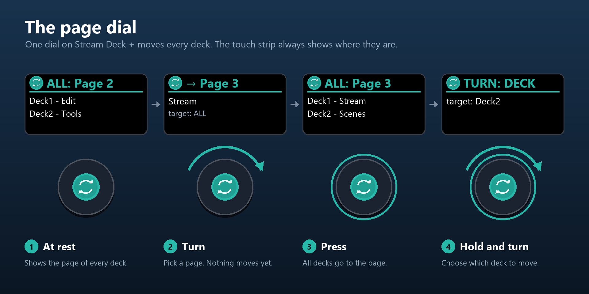
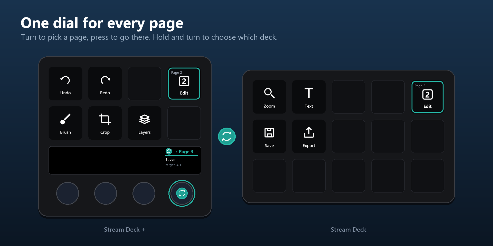

# Page dial

[Home](../README.md) · [Installation](Installation.md) · [Getting started](Getting-started.md) · [Actions](Actions.md) · **Page dial** · [Decks without a dial](No-dial.md) · [Virtual Stream Deck](Virtual-Stream-Deck.md) · [Colours](Colours.md) · [Folders](Folders.md) · [Troubleshooting](Troubleshooting.md)

---

The page dial is one dial on Stream Deck + that moves every deck. The DeckSync profile for Stream Deck + has it on dial 4 of every page.

- **Turn**: pick a page (1–10). The touch strip shows its name, nothing is sent yet.
- **Press**: go to that page on the target decks.
- **Hold and turn**: pick the target: ALL → each deck in turn → ALL, in both directions. Holding without turning does nothing.
- **Touch**: go to the page, same as press.

The chosen page and target are shared by all page dials and remembered across restarts.

## What the touch strip shows

- **All decks on the same page:** `ALL: Page 3`, then each deck with its own page name.
- **Decks on different pages:** `PAGES`, then one line per deck: `Deck1: Page 3 Edit`.
- **While you turn:** the page you are about to go to, its name, and the target.
- **While you hold:** `TURN: DECK` and the target you are choosing.

Give your decks names in the dial's settings and they replace Deck1, Deck2 on the strip.

---

Questions or a bug? Open an issue: https://github.com/BerrisNO/DeckSync/issues
