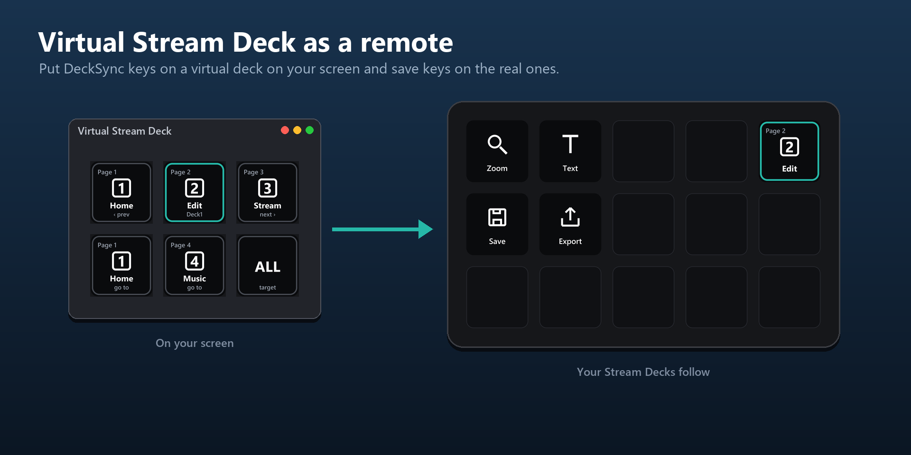

# Virtual Stream Deck

[Home](../README.md) · [Installation](Installation.md) · [Getting started](Getting-started.md) · [Actions](Actions.md) · [Page dial](Page-dial.md) · [Decks without a dial](No-dial.md) · **Virtual Stream Deck** · [Colours](Colours.md) · [Folders](Folders.md) · [Troubleshooting](Troubleshooting.md)

---

A Virtual Stream Deck on your screen can drive your physical decks and save keys on them. It needs no DeckSync profile and no page marker: you set it up yourself, in any grid size, with DeckSync's keys.

1. Enable Virtual Stream Deck in the Stream Deck app and create one.
2. Drag DeckSync actions onto it:
   - **Page step** (Previous and Next): moves all decks, or the Target key's choice. The keys show the page they lead to.
   - **Go to page**: one key per page you use often, for all decks or one page per deck.
   - **Page indicator**: shows where a deck is. Pick the deck in its settings.
   - **Target**: choose which deck Page step moves.
3. That is all. The virtual deck itself stays on its own page; it only controls the others.

The same works for any deck you would rather keep out of the sync: put the keys on a profile of your own.

---

Questions or a bug? Open an issue: https://github.com/BerrisNO/DeckSync/issues
